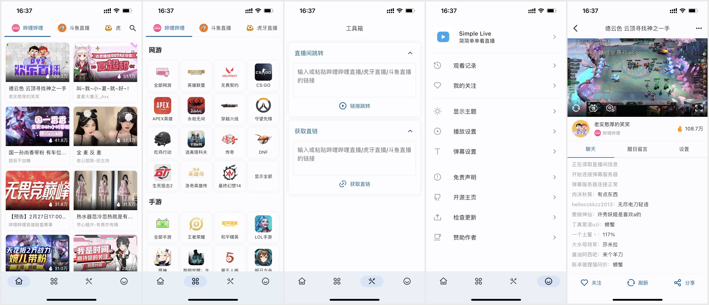
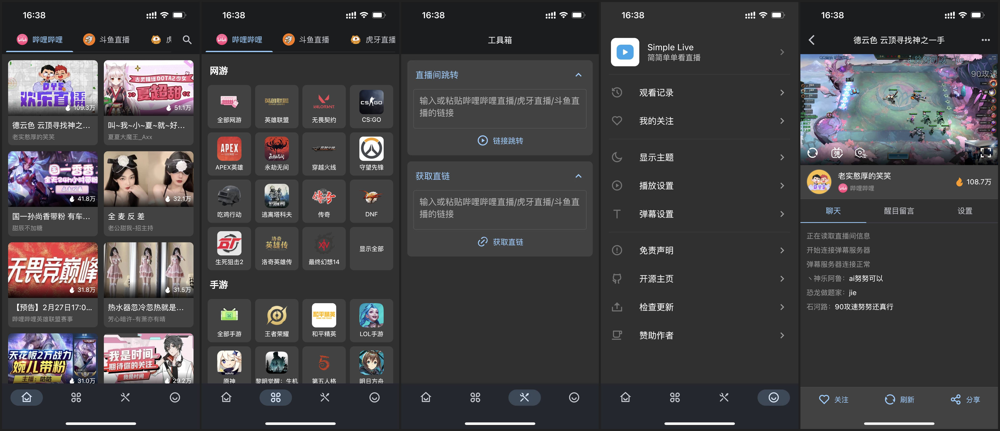
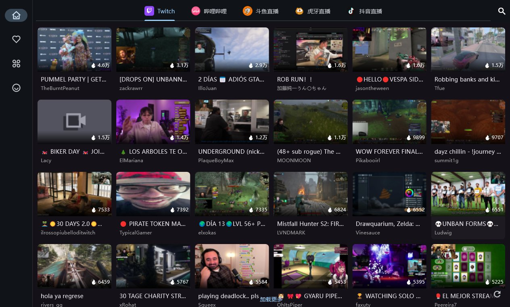

## THIS APP IS FREE FOREVER. IF YOU PAID TO DOWNLOAD IT, YOU HAVE BEEN SCAMMED: PLEASE REPORT THE PERSON WHO CHARGED YOU.

[简体中文](README.md) | English

    

<h2 align="center">simple_live_N</h2>

Simply watch live streams

simple_live_N is a modified version of [Simple Live](https://github.com/xiaoyaocz/dart_simple_live) by xiaoyaocz. It is based on upstream version 1.11.7 and released under the GPL-3.0 license. On top of the upstream features, we have added many more.

## Main new features

- [Live source subscriptions](https://github.com/NishinoAkii/simple_live_N-sources/blob/main/README.en.md): one script per platform, updated without reinstalling the app.
- Speed up to catch up: when the picture falls behind, playback speeds up slightly to get close to live again.
- Sync between devices: follows, watch history, settings and live source subscriptions sync over WebDAV or the LAN, with times converted between time zones.
- Danmaku in picture-in-picture: the floating window on Android and iOS can show danmaku, with its own style settings.
- Windows multi-window: up to 4 live rooms at once, with video rendered directly through Direct3D 11 for lower CPU use.
- Interface languages: Simplified Chinese, Traditional Chinese and English built in; [translations](https://github.com/NishinoAkii/simple_live_N-sources/blob/main/README.en.md) such as Japanese and Spanish can be downloaded in the app.

Twitch, Kick, YouTube and more are new too; see [Releases](https://github.com/NishinoAkii/simple_live_N/releases) for everything.

## Supported live platforms

- Huya

- Douyu

- Bilibili Live

- Douyin

- Twitch, Kick and YouTube (hidden on a new install; turn them on in the platform list under "Home settings")

- Other platforms through live source subscriptions

## Supported systems

- [x] Android
- [x] iOS
- [x] Windows `BETA`
- [x] macOS `BETA`
- [x] Linux `BETA`
- [x] Android TV `BETA`

## Project structure

- `simple_live_core`: the core library, which fetches stream information and danmaku from each site.
- `simple_live_console`: a console program built on simple_live_core.
- `simple_live_app`: the Flutter app built on the core library.
- `simple_live_tv_app`: the Flutter Android TV app built on the core library.

## Environment

Flutter: `3.50.0`

## Requirements

| System | Requirements |
|---|---|
| Windows | Windows 10 or later (64-bit). Install the [Microsoft Visual C++ Redistributable (x64)](https://aka.ms/vs/17/release/vc_redist.x64.exe); the graphics card and driver must support Direct3D 11. Web logins need the [Microsoft Edge WebView2 Runtime](https://developer.microsoft.com/microsoft-edge/webview2/), which is built into Windows 11. |
| Windows 7 | Windows 7 SP1 (64-bit) uses a separate Windows 7 package, which also needs the Microsoft Visual C++ Redistributable (x64). It has no system notifications for go-live alerts and no system sharing, draws video in a more compatible way that uses more CPU, and has not been tested on a real Windows 7 machine. The Windows 7 package keeps the features of 1.24.0 and only gets bug fixes from now on. Build instructions: [`windows7/README.md`](windows7/README.md) (in Chinese). |
| Android, Android TV | Android 7.0 or later. |
| iOS | iOS 15.0 or later. |
| macOS | macOS 12.0 or later. |
| Linux | Install libmpv; on Ubuntu and Debian, run `sudo apt install libmpv-dev mpv`. |

## References

This project is built on [Simple Live](https://github.com/xiaoyaocz/dart_simple_live) and draws on the projects below. If you find them useful, please give them a star.

[AllLive](https://github.com/xiaoyaocz/AllLive) `the C# version of the upstream project, worth a look if you are interested`

[dart_tars_protocol](https://github.com/xiaoyaocz/dart_tars_protocol.git)

[wbt5/real-url](https://github.com/wbt5/real-url)

[lovelyyoshino/Bilibili-Live-API](https://github.com/lovelyyoshino/Bilibili-Live-API/blob/master/API.WebSocket.md)

[IsoaSFlus/danmaku](https://github.com/IsoaSFlus/danmaku)

[BacooTang/huya-danmu](https://github.com/BacooTang/huya-danmu)

[TarsCloud/Tars](https://github.com/TarsCloud/Tars)

[YunzhiYike/douyin-live](https://github.com/YunzhiYike/douyin-live)

[5ime/Tiktok_Signature](https://github.com/5ime/Tiktok_Signature)

[June6699/dart_simple_live](https://github.com/June6699/dart_simple_live) `the Douyu QR login is based on its approach (GPL-3.0)`

[Predidit/Kazumi](https://github.com/Predidit/Kazumi) `the iOS picture-in-picture and the Direct3D 11 video rendering on Windows follow its implementation (GPL-3.0)`

## Disclaimer

This is a modified version for personal use.

All features of this project were developed from information publicly available on the internet.

This project does not provide a proxy or any network access. Some platforms cannot be reached directly from some regions; arranging network access is up to you.

This project is intended only for learning and sharing programming techniques. Commercial use is strictly prohibited, and any commercial activity has nothing to do with this project.

If this project infringes your legal rights, please contact the developer, and the content concerned will be removed promptly.

## License

This project is released under GPL-3.0, see [`LICENSE`](LICENSE). The third-party components in the packages and their licenses are listed in [`THIRD_PARTY_NOTICES.md`](THIRD_PARTY_NOTICES.md) (in Chinese).

## Data compatibility

This version is compatible with Simple Live's viewing data.

## Star History

<a href="https://www.star-history.com/#NishinoAkii/simple_live_N&Date">
 <picture>
   <source media="(prefers-color-scheme: dark)" srcset="https://api.star-history.com/svg?repos=NishinoAkii/simple_live_N&type=Date&theme=dark" />
   <source media="(prefers-color-scheme: light)" srcset="https://api.star-history.com/svg?repos=NishinoAkii/simple_live_N&type=Date" />
   
 </picture>
</a>
