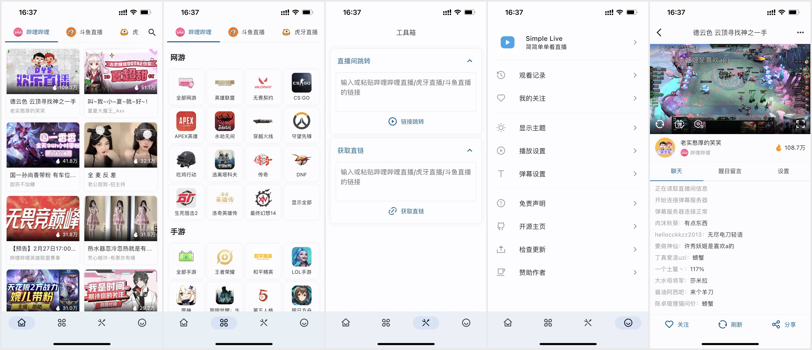
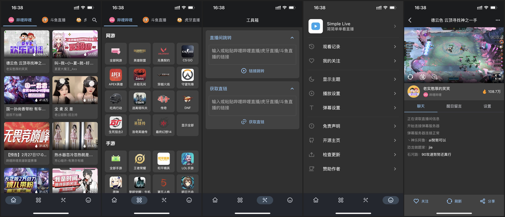

## 本应用永久免费。如果你付费下载了本应用，说明你被骗了，请投诉向你收费的人。

简体中文 | [English](README.en.md)

    

<h2 align="center">simple_live_N</h2>

简简单单的看直播

simple_live_N 是 [Simple Live](https://github.com/xiaoyaocz/dart_simple_live)（作者 xiaoyaocz）的修改版，以上游 1.11.7 版本为基础，依照 GPL-3.0 协议发布。在上游功能的基础上，我们实现了更多功能，见后文的[主要功能](#主要功能)。

## 支持直播平台：

- 虎牙直播

- 斗鱼直播

- 哔哩哔哩直播

- 抖音直播

- Twitch、Kick、YouTube（新安装时默认隐藏，可在“主页设置”的平台列表中开启）

- 其他平台可通过直播源订阅接入

## APP支持平台

- [x] Android
- [x] iOS
- [x] Windows `BETA`
- [x] MacOS `BETA`
- [x] Linux `BETA`
- [x] Android TV `BETA`

## 项目结构

- `simple_live_core` 项目核心库，实现获取各个网站的信息及弹幕。
- `simple_live_console` 基于simple_live_core的控制台程序。
- `simple_live_app` 基于核心库实现的Flutter APP客户端。
- `simple_live_tv_app` 基于核心库实现的Flutter Android TV客户端。

## 环境

Flutter: `3.50.0`

## 运行要求

| 系统 | 要求 |
|---|---|
| Windows | Windows 10 或更高版本（64 位）。需要安装 [Microsoft Visual C++ Redistributable (x64)](https://aka.ms/vs/17/release/vc_redist.x64.exe)，显卡及驱动需支持 Direct3D 11。网页登录需要 [Microsoft Edge WebView2 Runtime](https://developer.microsoft.com/microsoft-edge/webview2/)，Windows 11 已内置。 |
| Windows 7 | Windows 7 SP1（64 位）请使用单独的 Windows 7 安装包，同样需要 Microsoft Visual C++ Redistributable (x64)。该安装包不支持开播提醒的系统通知和系统分享，视频采用兼容性更好的绘制方式，CPU 占用较高，且尚未在 Windows 7 实机上测试。Windows 7 安装包维持 1.24.0 的功能，后续只修复问题，不再新增功能。编译方法见 [`windows7/README.md`](windows7/README.md)。 |
| Android、Android TV | Android 7.0 或更高版本。 |
| iOS | iOS 15.0 或更高版本。 |
| macOS | macOS 12.0 或更高版本。 |
| Linux | 需要安装 libmpv，Ubuntu 和 Debian 可执行 `sudo apt install libmpv-dev mpv`。 |

## 参考及引用

本项目以 [Simple Live](https://github.com/xiaoyaocz/dart_simple_live) 为基础，并参考了以下项目。如果觉得有帮助，欢迎为它们点个 Star。

[AllLive](https://github.com/xiaoyaocz/AllLive) `上游项目的C#版，有兴趣可以看看`

[dart_tars_protocol](https://github.com/xiaoyaocz/dart_tars_protocol.git)

[wbt5/real-url](https://github.com/wbt5/real-url)

[lovelyyoshino/Bilibili-Live-API](https://github.com/lovelyyoshino/Bilibili-Live-API/blob/master/API.WebSocket.md)

[IsoaSFlus/danmaku](https://github.com/IsoaSFlus/danmaku)

[BacooTang/huya-danmu](https://github.com/BacooTang/huya-danmu)

[TarsCloud/Tars](https://github.com/TarsCloud/Tars)

[YunzhiYike/douyin-live](https://github.com/YunzhiYike/douyin-live)

[5ime/Tiktok_Signature](https://github.com/5ime/Tiktok_Signature)

[June6699/dart_simple_live](https://github.com/June6699/dart_simple_live) `斗鱼扫码登录参考了该项目（GPL-3.0）`

[Predidit/Kazumi](https://github.com/Predidit/Kazumi) `iOS 画中画和 Windows 上的 Direct3D 11 视频渲染参考了该项目的实现（GPL-3.0）`

## 声明

本项目是个人自用的修改版。

本项目的所有功能都是基于互联网上公开的资料开发。

本项目不提供网络代理或任何网络访问服务。部分平台在某些地区无法直接访问，需要自行解决网络连接。

本项目仅用于学习交流编程技术，严禁将本项目用于商业目的。如有任何商业行为，均与本项目无关。

如果本项目存在侵犯您的合法权益的情况，请及时与开发者联系，开发者将会及时删除有关内容。

## 许可

本项目依照 GPL-3.0 发布，见 [`LICENSE`](LICENSE)。安装包中的第三方组件及其许可见 [`THIRD_PARTY_NOTICES.md`](THIRD_PARTY_NOTICES.md)。

## 数据兼容

本版本兼容 Simple Live 的观看数据。

## 主要功能

- [直播源订阅](https://github.com/NishinoAkii/simple_live_N-sources)：一个脚本接入一个平台，脚本更新后无需重装 App。
- 追帧加速：画面落后时略微加速，追回到接近实时。
- 多设备同步：关注、观看记录、设置和直播源订阅通过 WebDAV 或局域网同步。

另有 Twitch、Kick、YouTube 等新平台，完整内容见 [Releases](https://github.com/NishinoAkii/simple_live_N/releases)。

## Star History

<a href="https://www.star-history.com/#NishinoAkii/simple_live_N&Date">
 <picture>
   <source media="(prefers-color-scheme: dark)" srcset="https://api.star-history.com/svg?repos=NishinoAkii/simple_live_N&type=Date&theme=dark" />
   <source media="(prefers-color-scheme: light)" srcset="https://api.star-history.com/svg?repos=NishinoAkii/simple_live_N&type=Date" />
   
 </picture>
</a>
